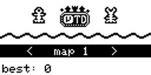
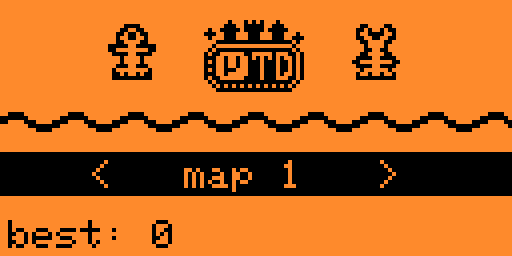
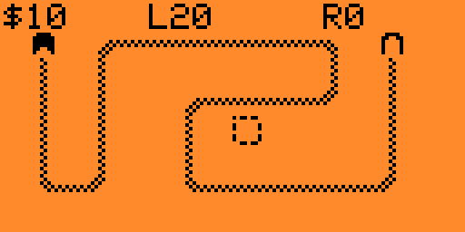
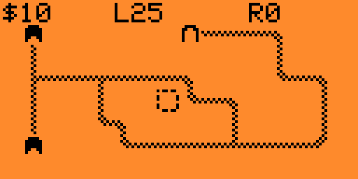
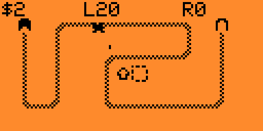

<p align="center">
  
</p>

A tower defense game for the Flipper Zero, played on a 16x8 grid of 8x8 tiles
across the whole 128x64 one-bit screen. Creeps walk a fixed path from the
entrance to the exit, you build and upgrade towers along it between waves, and
every wave is bigger and nastier than the one before. There is no last wave:
the game ends when your lives run out, and the round you reached is your score.

This is a port, not an original game. **MicroTD** was written by
**Miloslav "drummyfish" Ciz** for the [Arduboy](https://www.arduboy.com) and
released into the public domain. This repository carries it over to the Flipper
Zero: the Arduino layer is gone, and the game now talks to the Flipper API
directly, drawing into the firmware's canvas buffer, playing its tones on the
speaker and keeping its records on the SD card.

<p align="center">
  
  
</p>
<p align="center">
  
  
</p>

## Maps

| Map | Paths | Lives | Money | |
|---|---|---|---|---|
| 1 | 1 | 20 | $10 | A single path, the place to learn the towers |
| 2 | 2 | 25 | $10 | Two paths that merge into a shared exit |
| 3 | 2 | 20 | $10 | Two separate paths from opposite corners |
| 4 | 2 | 10 | $8 | One entrance that forks at the far end, the tightest map |
| 5 | 2 | 30 | $22 | Two paths snaking in opposite directions, the heaviest waves |

Each map has its own spawner. A wave is a function of the round number alone:
the number of creeps grows with every round, the range of creep types slides up
the list, and the leader of each group gets up to three extra lives, so it
respawns at the entrance with full health every time it is killed. A wave holds
at most 50 creeps.

## Towers

| Tower | Price | Range | Damage | Upgrades | |
|---|---|---|---|---|---|
| **Guard** | $8 | 30 | 2 | range, speed | Cheap and fast |
| **Cannon** | $8 | 27 | 2 | range, damage | Half damage splashes around the target; cannot hit bats |
| **Ice** | $17 | 26 | 0 | speed, range | Freezes a creep, then moves on to the next unfrozen one |
| **Electro** | $30 | 35 | 4 | damage, shock | Shock gives every hit a one in three chance to freeze |
| **Sniper** | $45 | 60 | 3 | speed, range | Covers nearly half the screen |
| **Magic** | $60 | 25 | 2 | damage, aura | The aura speeds up every non-magic tower in the 3x3 around it |
| **Water** | $100 | 40 | 7 | range, speed | 2x2 tiles; its wave can knock creeps back down the path |
| **Fire** | $100 | 38 | 8 | range, damage | 2x2 tiles, the hardest hitter, with splash |

Range is in pixels. Either upgrade costs two thirds of the build price, a range
upgrade adds a quarter, a damage upgrade adds half, and selling a tower returns
half of its build price. Towers are built only between waves.

## Creeps

Spider, lizard, snake, wolf, bat, ent, big spider, ghost, ogre, dino and demon,
the order in which the waves bring them in, from a 7 health spider to 63 health
dinos and demons. Killing one pays its reward, and one that reaches the
exit takes the same number of lives. Surviving a wave pays $5 plus a quarter of
the round number. Five of them break the rules:

- **Wolf** shakes off a freeze in half the time
- **Bat** is immune to cannons
- **Big spider** splits into two small spiders when it dies
- **Ghost** is immune to guards, cannons and snipers
- **Demon** can only be hurt by water and fire

## Controls

On the map:

| Key | Action |
|---|---|
| Arrows | move the cursor |
| OK between waves | open the action bar for the tile under the cursor |
| OK held during a wave | show a health bar over every creep |
| OK + Back during a wave | fast forward, five times normal speed |
| Back held | hide the info bar to see the tiles behind it |
| Back long | leave the map for the menu |

In the action bar, **Left** and **Right** pick between the eight towers, the two
upgrades, sell, next wave and quit, **OK** confirms and **Back** closes the bar.
Selling and quitting ask first.

In the menu, **Left** and **Right** choose a map or the sound switch, **OK**
starts the map or toggles sound, and a long press of **Back** leaves the app.
Sound starts off when the Flipper is in stealth mode.

## How it works

The game logic is the original MicroTD, kept close to the Arduboy code and
written to fit its 2.5 KB of RAM. A path is up to ten segments of one byte each,
two bits of direction and six of length, and a creep stores only its distance
along the path in pixels; its position on the screen is found by walking the
segments. A tower packs its type, its upgrades and its attack progress into a
single byte, and a creep packs its health and its extra lives the same way.

The port replaces everything under that logic. The game draws straight into
the firmware's 1 KB canvas buffer through its own 1bpp primitives, and its text
goes through the firmware font. Input arrives as Flipper key events through a
message queue and is folded into the button bitmask the game expects, with Back
standing in for the Arduboy's second button: pressed together with another key
it is that button, held alone it leaves the map or the app. The frame loop runs
at 60 frames per second, tones go to the speaker, and the best round of every
map is kept in five bytes at `/ext/apps_data/microtd/eeprom.bin`, written the
moment a run ends on a new record.

## Building

The easiest way is [qUnleashed Desktop](https://github.com/DarkFlippers/qUnleashed)
and its Flibler tool (Tools > Flibler): point it at this repository, either the
Git URL or a local folder, pick the firmware channel, and it builds the `.fap`
on your computer when the SDK and toolchain are ready, or on the build server
otherwise, and can install it straight onto the connected Flipper.

The manual way is the firmware's build tool. Put the repository in
`applications_user/` of an Unleashed (or compatible) firmware tree and run:

```
./fbt fap_microtd
```

## License

The Flipper Zero port is released under the [MIT License](LICENSE).
`game/microtd.cpp` is derived from the original game and stays under
[CC0 1.0](https://creativecommons.org/publicdomain/zero/1.0/), together with the
port's changes to it. The preview animation is the original author's, also CC0.

## Credits

**MicroTD** is the work of **Miloslav "drummyfish" Ciz** (2018) -
[drummyfish.itch.io/microtd](https://drummyfish.itch.io/microtd).

The Flipper Zero port is by ApertureFox Technology.

## Donation

| Service | Remark | QR Code | Link |
|---|---|---|---|
|  **Boosty** | Support the project | <div align="center"><a href="https://boosty.to/apfxtech/donate"></a></div> | [boosty.to/apfxtech/donate](https://boosty.to/apfxtech/donate) |
|  **YooMoney** | RU payments only | <div align="center"><a href="https://yoomoney.ru/fundraise/1IV33POM6H4.260711"></a></div> | [yoomoney.ru/fundraise/1IV33POM6H4.260711](https://yoomoney.ru/fundraise/1IV33POM6H4.260711) |
